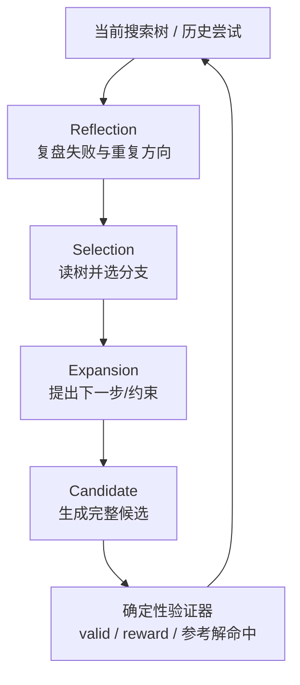
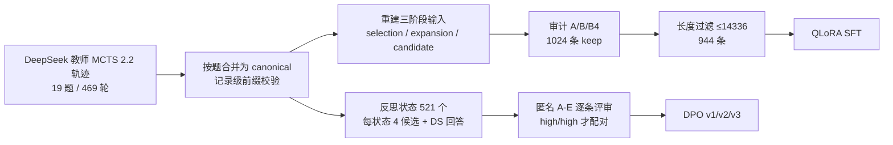

# 项目汇报大纲：面向 HypoSpace 的搜索式假设生成与轻量后训练

> 用途：期末报告 / 口头汇报底稿。  
> 数据快照：2026-11-27 21:05（北京时间）；V3 混合与全阶段验证仍在运行，文内标注“在途/未完成”的数字不是最终成绩。

> **【必须二次核验】**
> 本大纲是写作底稿，不是最终事实清单。提交/答辩前请逐项自行复核：
>
> | 信息 | 在本大纲的位置 | 核验来源 |
> |---|---|---|
> | 覆盖率、找到解数、题数 | 6.2–6.5 | 服务器 `quick3/summary.json`、`tasks.json`、逐题 result；本地 `training/server-archive-20261127/eval/` |
> | 训练 loss/margin/步数/显存 | 6.6 | `adapter/status.json`、`pipeline.log`、`adapter/history.json` |
> | token 平均与合计 | 6.8 | 逐题 result 的 `api_requests.response.usage.total_tokens` 重新汇总 |
> | 数据集条数、排除数、SHA | 5.1、6.1、附录 B | `training/data/*/manifest.json`、`datasets/*/manifest.json`、`snapshot_manifest.json` |
> | V3 混合/全阶段当前值 | 6.5 | `quick3/tasks.json`、`summary.json`、`results/dpo-reflection-v3-ep1/`、`results/dpo-v3-full-ep1/`；完成后必须替换 |
> | 文献页码/DOI | 3.2、10 | 出版社/arXiv 页面；未核验的保留“需要补充” |
> | 服务器路径与端口 | 4.6、附录 B | 当前 `state.json` 与 SSH 配置；端口会变 |
>
> 尤其是 V3 与采集状态是动态的，若报告晚于 2026-11-27 21:05，必须重新取数；不能直接引用本大纲里的在途数字。

---

## 0. 一页摘要（Abstract 草稿）

**主题**：在欠定（underdetermined）科学推理任务中，让 LLM 不只是给出一个正确答案，而是尽可能覆盖一组结构不同、但都与观测一致的假设。

**方法**：以 HypoSpace 的三类确定性验证任务为基准，使用 Stage-MCTS 2.2（反思—选节点—扩展—候选生成）作为搜索框架；用 DeepSeek 教师轨迹整理出 1024 条阶段 SFT 数据，经 QLoRA 训练 SFT 适配器；再构造反思阶段的偏好对，训练 DPO v1/v2/v3，并设计“V3 只做反思、SFT 做其余步骤”的混合推理与全阶段 V3 对照。

**主要结果（quick3 三题，45 参考解）**：

- base Qwen3-8B：27/45，60.0%
- linear-ep1：36/45，80.0%
- SFT `sft-pruned-v1-ep1`：36/45，80.0%
- DPO v1：29/45，64.4%；DPO v2：31/45，68.9%
- SFT ep1 在 mixed100（25 题 293 解）已完成题 185/245（75.5%），含在途 206/293（70.3%）
- DPO v3 混合组 / 全阶段组仍在跑，原三题分别约 16/45、19/45，未完成

**结论**：**SFT 有明确提升；DPO 尚未显示稳定的额外收益。** 在已有同题对照中，未微调的 MCTS 没有超过 memory 基线；单题约 0.4–0.6M tokens、25 题约 8–10M，受时间和算力限制，没有在 136 题全库上做多模型多 seed 验证。V3 混合反思的最终结论要等验证跑完。

---

## 1. 研究主题与问题

### 1.1 背景：欠定问题与“多假设覆盖”

- 科学观测往往不能唯一确定机制：同一组观测可能对应多个结构不同的假设。
- 传统评测只看单答案正确率，会掩盖“mode collapse”：模型反复给出同一种解释。
- HypoSpace 把模型视为**有限假设集合的采样器**，用 Validity / Uniqueness / Recovery 三个指标衡量集合质量。

### 1.2 研究问题

- **RQ1**：在固定题库和固定搜索预算下，搜索式 Agent（MCTS + 反思）能否提高参考解覆盖率？
- **RQ2**：用教师轨迹做 QLoRA SFT，能否把“会搜索”的能力迁移到 8B 模型？
- **RQ3**：在 SFT 基础上，用反思阶段的偏好数据做 DPO，能否带来稳定的额外收益？
- **RQ4**：如果 DPO 只在反思阶段更强，能否用“V3 反思 + SFT 其余步骤”的混合路由获得收益？

### 1.3 研究意义

- **科学发现**：从“猜一个答案”转向“枚举可解释空间”，更符合科学推理的实际形态。
- **方法学**：把 test-time search、轨迹蒸馏、偏好优化放进同一个可复现实验框架，分离数据、搜索和训练的作用。
- **工程**：在 8B 模型 + 消费级 4090/5090 的动态 GPU 池上完成训练与评测，验证低资源实验室的可行路径。

---

## 2. 研究进度（截至 2026-11-27）

| 阶段 | 时间 | 内容 | 状态 |
|---|---|---|---|
| 基线 | 11-17 | direct / memory / MCTS 1.0 / 2.0 / 2.1，105/136/27 题 | 完成（历史） |
| 服务器化 | 11-24 | Qwen3-8B vLLM、网关、树工具、easy 105 题 | 完成 |
| 动态池 | 11-25 | 九卡角色路由、排空/预约、运行时 LoRA | 完成并实机验证 |
| 数据与 SFT | 11-26 | DS 轨迹规范化、审计、309/944 条 QLoRA | 完成 |
| DPO v1/v2 | 11-27 | 58/130 对，quick3 三题验证 | 完成 |
| DPO v3 | 11-27 | 185 对；混合组 25 题 + 全阶段组 3 题 | **运行中** |
| 数据归档 | 11-27 | 服务器训练数据/参数/评测摘要本地归档 | 完成快照 |

当前运行态：

- SFT ep1：24/25 题完成，含在途 206/293（70.3%）。
- DPO v3 混合组：25 题（原 3 + mixed100 22），少量完成，多题 pending/running。
- DPO v3 全阶段组：3 题在跑。
- 原始候选采集：`stopped`（PAUSE），1107/2084。

---

## 3. 相关工作与参考文献

### 3.1 直接支撑本项目的文献

| 文献 | 作用 |
|---|---|
| Chen et al., *HypoSpace: Evaluating LLM Creativity as Set-Valued Hypothesis Generators under Underdetermination*, arXiv:2510.15614, 2025 | 基准、三领域、Validity/Uniqueness/Recovery 指标 |
| Hu et al., *LoRA: Low-Rank Adaptation of Large Language Models*, arXiv:2106.09685, 2021 | 低秩适配器 |
| Dettmers et al., *QLoRA: Efficient Finetuning of Quantized LLMs*, arXiv:2305.14314, 2023 | 4-bit NF4 + LoRA，单机微调 |
| Rafailov et al., *Direct Preference Optimization*, arXiv:2305.18290, 2023 | DPO 目标 |
| Yao et al., *Tree of Thoughts*, arXiv:2305.10601, 2023 | 树搜索/多分支推理 |
| Shinn et al., *Reflexion*, arXiv:2303.11366, 2023 | 语言化反思与重试 |
| Madaan et al., *Self-Refine*, arXiv:2303.17651, 2023 | 迭代自我修正 |
| Zelikman et al., *STaR: Bootstrapping Reasoning With Reasoning*, arXiv:2203.14465, 2022 | 用教师/自生成轨迹做监督 |
| Qwen Team, *Qwen3 Technical Report*, arXiv:2505.09388, 2025 | 基座模型 |

### 3.2 MCTS 核心文献（必须引用）

- Coulom, R. *Efficient Selectivity and Backup Operators in Monte-Carlo Tree Search.* Computers and Games (CG 2006), LNCS 4630, pp. 72–83. —— MCTS 早期代表性工作，选择/回传算子。
- Kocsis, L., & Szepesvári, C. *Bandit Based Monte-Carlo Planning.* ECML 2006, LNCS 4212, pp. 282–293. —— UCT，把 bandit 上置信界用于树选择，是本项目 MCTS 选择阶段的理论来源。
- Browne, C. B., Powley, E., Whitehouse, D., Lucas, S. M., Cowling, P. I., Rohlfshagen, P., Tavener, S., Perez, D., Samothrakis, S., & Colton, S. *A Survey of Monte Carlo Tree Search Methods.* IEEE Transactions on Computational Intelligence and AI in Games, 4(1):1–43, 2012. —— MCTS 综述，适合支撑方法背景。
- Silver, D., et al. *A General Reinforcement Learning Algorithm that Masters Chess, Shogi, and Go through Self-Play.* Science, 362(6419):1140–1144, 2018. —— AlphaZero，MCTS + 学习到的策略/价值的代表工作。

> 说明：以上为 MCTS 通用文献；具体出版社页码/DOI 我未联网核验。若报告要求精确引用格式，请在提交前核对；无法核验的条目在本大纲中标注“需要补充”。本项目不是复现 AlphaZero，只借用“树 + 奖励 + 回溯”的搜索范式。

### 3.3 可选补充

- 如篇幅有限，MCTS 至少保留 Kocsis & Szepesvári (2006) 与 Browne et al. (2012)；AlphaZero 可作为应用示例引用。

---

## 4. 方法

### 4.1 任务与指标

HypoSpace 三类任务，均有确定性验证器和可枚举的假设空间：

- 因果图：从扰动实验恢复 DAG；
- 3D 体素：从俯视图恢复满足重力/支撑约束的结构；
- 布尔逻辑：从部分真值表恢复结构不同的表达式。

指标：

- **Validity**：提交中满足观测的比例；
- **Uniqueness**：有效提交中结构不重复的比例；
- **Recovery / Coverage**：找到的参考解数 / 参考解总数。

本汇报主要报告 **Recovery**，并区分：

- **按解汇总（pooled / micro）**：\(\sum found / \sum refs\)，解多的题权重大；
- **按题平均（macro）**：先算每题覆盖率，再对题等权平均；未完成题不计入 macro。

### 4.2 Stage-MCTS 2.2

每轮把“思考”拆成四个独立阶段，避免一个提示词同时承担多种职责：



版本演进：

- 1.0：提示词选择分支；
- 2.0：模型通过工具读取完整树；
- 2.1：允许重复提交，增加基于理论分析的 EXHAUSTED 规则；
- 2.2：阶段隔离 + 格式示例（`isolated_examples_v1`），降低协议错误。

### 4.3 数据流水线：从教师轨迹到阶段 SFT



关键规则：

- 同一任务多次运行合并为**一份** canonical 数据，不按运行次数拆文件；
- 只收 reference_hit、未截断、无协议错误的轮次；
- 按 `hypothesis_key` 去重；
- 重建输入必须仍容纳教师输出（Branch 在菜单内、Plan 匹配、candidate 匹配）；
- 训练数据稀少，已完成题全部入库；评测阶段对测试集做减法。

### 4.4 QLoRA SFT

- 4-bit NF4 双重量化，BF16 计算；
- LoRA r=16、alpha=32、dropout 0.05，q/k/v/o/gate/up/down 七类投影；
- assistant-only loss：只对 assistant token 计算交叉熵；
- 微批 1、梯度累积 16，双卡模型分片不乘 2；
- 修复 `model_accepts_loss_kwargs=False`，让 Trainer 正确处理累积与尾批归一化；
- 309 条 A 数据：1 epoch / 2 epoch；944 条删减版：2 epoch，取 checkpoint-59 作为 ep1、checkpoint-118 作为 ep2。

### 4.5 DPO

标准 DPO 目标：

\[
\mathcal{L}_{DPO} = -\mathbb{E}_{(x,y_w,y_l)}
\log \sigma\!\left(\beta\left[
\log \frac{\pi_\theta(y_w|x)}{\pi_{ref}(y_w|x)}
- \log \frac{\pi_\theta(y_l|x)}{\pi_{ref}(y_l|x)}
\right]\right)
\]

- policy 起点与冻结 reference 都是 `sft-pruned-v1-ep1`，不接着上一版 DPO 权重；
- 只计算 assistant completion 的 log probability；
- 数据：离线评审的 chosen=helpful/high、rejected=harmful/high，每个状态最多一对；
- v1：58 对，8 更新，lr 5e-6；
- v2：130 对，9 更新，lr 1e-6，beta 0.1；
- v3：185 对，12 更新，lr 1e-6，beta 0.1，每 3 步保存；
- v3 增加 `chosen_logp_delta`、`rejected_logp_delta`、per-token NLL、batch pair accuracy（这些不是独立验证集成绩）。

### 4.6 混合路由与动态 GPU 池

- 角色：`shared` / `reserved` / `training` / `draining` / `disabled`；
- 网关只把请求路由给“模型匹配且角色允许”的卡，**缺适配器不回退 base**；
- 训练前 `drain` 等当前 API 完成，再 `training`；结束后归还 `shared`；
- 支持 vLLM 运行时加载 LoRA，避免重启引擎；
- V3 混合组：反思用 `dpo-reflection-v3-ep1`，读树/选择/扩展/候选用 `sft-pruned-v1-ep1`；
- V3 全阶段组：所有阶段用 `dpo-reflection-v3-ep1`，队列别名 `dpo-v3-full-ep1`。

---

## 5. 实验设置

### 5.1 题库

| 题库 | 题数 | 参考解 | 用途 |
|---|---:|---:|---|
| quick3 | 3 | 45 | 3D 9、布尔 12、因果 24；主快速对照 |
| mixed100_v1 | 25 | 293 | 3D 93、布尔 100、因果 100；扩展验证 |
| 困难抽样 19 题 | 19 | 358 | 教师数据来源与历史对照 |
| hard_balanced | 136 | 3,600 | 正式高难题库（历史） |

### 5.2 模型

| 模型 | 数据/初始化 | 训练 |
|---|---|---|
| `base` | Qwen3-8B | 无 |
| `linear-ep1` / `linear-ep2` | 309 条 A 数据 | 1 / 2 epoch，lr 1e-4 |
| `sft-pruned-v1-ep1` | 944 条删减版 | 2 epoch 的 checkpoint-59 |
| `sft-pruned-v1-ep2` | 944 条删减版 | 2 epoch 的 checkpoint-118 |
| `dpo-reflection-v1-ep1` | 58 对 | 8 更新，lr 5e-6 |
| `dpo-reflection-v2-ep1` | 130 对 | 9 更新，lr 1e-6 |
| `dpo-reflection-v3-ep1` | 185 对 | 12 更新，lr 1e-6 |
| `dpo-v3-full-ep1` | 同 V3 权重 | 全阶段使用 V3 的队列别名 |

### 5.3 指标与预算

- 覆盖率：按解汇总 + 按题 macro 同时报告；
- 每题搜索上限 `call_cap`：9 解题 28、12 解题 34、24 解题 58、48 解题 106 等；
- 报告 `found/refs`、`used/cap`、剩余预算；
- 训练指标：loss、reward_margin、pair_accuracy、峰值显存、更新步数。

### 5.4 计算环境

- 四号机 `EEC430004-4090`：双 4090 训练/发布，单 5090 推理；
- 动态池最多 10 张卡（4090/5090 混合），按模型能力路由；
- 训练与验证互斥：训练卡 `training`，发布前 `draining`，完成后归还。

---

## 6. 实验结果

> 本章所有覆盖率、训练指标、token 数都是写作底稿；提交前必须按顶部“二次核验”表重新取数确认。

### 6.1 数据审计

| 数据批 | 输入 | keep | reject | uncertain | 备注 |
|---|---:|---:|---:|---:|---|
| A（309 条） | 309 | 300 | 2 | 7 | 早期三阶段 |
| B（4 题） | 507 | 487 | 0 | 20 | 另有非命中推理 21 条单独存放 |
| B4（19 题） | 243 | 237 | 0 | 6 | 覆盖率 1.0 |
| 合并 | 1,024 | 1,024 | — | — | selection 346 / expansion 332 / candidate 346 |
| 长度过滤 | 1,024 | 944 | 80 | — | 超过 14336 token 的样本独立留存 |

### 6.2 SFT：base vs 适配器（quick3，45 解）

| 模型 | 找到/参考 | 覆盖率 | macro | 协议错误 |
|---|---:|---:|---:|---:|
| base | 27/45 | 60.0% | 0.574 | 2 |
| linear-ep1 | 36/45 | **80.0%** | 0.819 | 5 |
| linear-ep2 | 30/45 | 66.7% | 0.685 | 0 |
| sft-ep2 | 23/45 | 51.1% | 0.537 | 1 |
| sft-ep1 | 36/45 | **80.0%** | 0.806 | 0 |

```
base      ████████████████        60.0%
linear1   █████████████████████   80.0%
linear2   ██████████████████      66.7%
sft-ep2   ██████████████          51.1%
sft-ep1   █████████████████████   80.0%
```

**解读**：相对 base，适配器有明确提升（60%→80%）；但 sft-ep1 与 linear-ep1 打平，sft-ep2 反而下降。说明“有 SFT”不等于“SFT 一定更好”，数据量、checkpoint、学习率策略都在起作用。

### 6.3 SFT ep1 在 mixed100（25 题 293 解）

已完成 24/25 题；含在途 `n1_002`：

| 维度 | 已完成题 | 含在途 |
|---|---:|---:|
| 3D | 50/66（75.8%） | 68/93（73.1%） |
| 布尔 | 69/100（69.0%） | 69/100（69.0%） |
| 因果 | 48/52（92.3%） | 69/100（69.0%） |
| 合计 | **167/218（76.6%）** | **206/293（70.3%）** |

- 已完成题 macro：0.821；
- 在途 `n1_002`：21/48，搜索 70/106，剩 36；
- 结论：SFT ep1 在扩展题库上仍明显高于 base 的 quick3 水平，但不同领域不均衡；因果已完成题很高，因果在途题拖低整体。

### 6.4 DPO：是否带来额外收益（quick3，45 解）

| 模型 | 找到/参考 | 覆盖率 | 相对 SFT ep1 |
|---|---:|---:|---:|
| sft-ep1 | 36/45 | 80.0% | — |
| dpo-v1 | 29/45 | 64.4% | -15.6pp |
| dpo-v2 | 31/45 | 68.9% | -11.1pp |
| dpo-v3 混合（原三题，未完成） | 16/45 当前 | 未完成 | 不作最终比较 |
| dpo-v3 全阶段（未完成） | 19/45 当前 | 未完成 | 不作最终比较 |

**解读**：v1/v2 在相同三题上低于 SFT 起点，**DPO 尚未显示稳定的额外收益**。可能原因：

- 偏好数据规模小（58/130/185 对），且 chosen 以 DS 历史回答为主，存在来源/长度偏差；
- 评审是离线单读者，标签有噪声；high/high 过滤后样本更少；
- 只在反思阶段做偏好，可能改变“说什么”，但没有改变搜索/候选生成能力；
- DPO 训练步数少（8/9/12），且 v1 曾有 OOM/重启，训练稳定性有限。

### 6.5 V3 混合与全阶段（进行中）

设计：混合组反思=V3、其余=SFT；全阶段组全部=V3。

当前（未完成，不报最终覆盖率）：

| 组 | 3D | 布尔 | 因果 | 备注 |
|---|---:|---:|---:|---|
| V3 混合（原三题） | 5/9 | 4/12 | 7/24 | 路由校验通过 |
| V3 全阶段（原三题） | 5/9 | 5/12 | 9/24 | 路由校验通过 |
| V3 混合 mixed100 | 已完成 3 个 easy 任务，8/8 | | | 其余 pending/running |

- 训练：12/12 更新，loss 0.5615，margin 0.2844，pair_acc 1.0，峰值 14.9/18.3 GiB；
- 路由：反思响应 model=V3，搜索记录 model=SFT ep1（混合组），无 base 回退；
- 结论待三题跑完，当前不能声称混合优于全阶段或 SFT。

### 6.6 训练与资源

| 运行 | 数据 | 更新 | lr | loss | 备注 |
|---|---:|---:|---:|---:|---|
| SFT 309 ep1 | 309 | 20 | 1e-4 | 1.2097 | 596s，峰值 10.8/16.8 GiB |
| SFT 944 ep2 | 944 | 118 | 5e-5 | 0.9280 | 4931s，峰值 11.1/17.3 GiB |
| DPO v2 | 130 对 | 9 | 1e-6 | 0.6234 | margin 0.1449 |
| DPO v3 | 185 对 | 12 | 1e-6 | 0.5615 | margin 0.2844，pair_acc 1.0 |

### 6.7 工程验证

- 动态池实机切换：4090 在 2048-token 诊断请求下进入 draining，请求完成后释放显存，完成 2 次真实 QLoRA 更新（11.64s），训练退出 0 后自动重启推理并归还 shared；期间旧题继续、无全局暂停。
- 运行时 LoRA 加载、节点代理 SHA 校验、失败不回退 base、发布失败保留 failed 收据。
- 采集/训练/验证共用 9–10 卡池，按角色和模型匹配路由。

### 6.8 Token 成本：为什么只做小规模验证

单题成本按结果 JSON 中所有 `api_requests.response.usage.total_tokens` 求和（含反思与多阶段请求）。**平均 token 与覆盖率都只统计已完成题**；在途/未完成题不计入。quick3 三题均已完成：

| 方法 | 平均 tokens/题 | 三题合计 | quick3 覆盖率 |
|---|---:|---:|---:|
| base | 565k | 1.69M | 60.0% |
| linear-ep1 | 518k | 1.55M | 80.0% |
| linear-ep2 | 487k | 1.46M | 66.7% |
| sft-ep2 | 498k | 1.50M | 51.1% |
| sft-ep1 | 507k | 1.52M | 80.0% |
| dpo-v1 | 533k | 1.60M | 64.4% |
| dpo-v2 | 383k | 1.15M | 68.9% |

> DPO v3 仍在运行，平均 token 与覆盖率都不计入本表；不能用在途数字与已完成方法比较。

mixed100 的 SFT ep1（只算已完成）：**21 个新增题共 6.50M tokens，平均 310k/题，覆盖率 149/200（74.5%）**；加上原 quick3 三题的 1.52M，24 个已完成任务合计 8.02M，平均 334k/题。按已完成题均值估算 25 题约 **8.4M tokens**。

按这个量级：

- 136 道 hard_balanced 全跑一遍，单模型约 **68M tokens**（136 × 0.5M）；
- 6 个模型 × 3 个 seed × 多次消融，就是数亿 tokens 和数十小时 GPU；
- 因此本项目只在 quick3（3 题 45 解）和 mixed100（25 题 293 解）上做主要对照，没有在 136 题全库上做多模型、多 seed 的完整验证；这是**时间与算力限制**，不是认为大题量不重要。

> 历史同题对照中，**未微调的 MCTS 没有超过 memory 基线**；SFT 是第一个相对 base 有明确提升的适配器路线。DPO 在 quick3 上没有复制这一提升，因此当前结论只覆盖小规模验证。

---

## 7. 讨论

### 7.1 SFT 的提升来自哪里

- 教师轨迹提供了“如何分阶段反思/扩展/提交”的格式与策略；
- assistant-only loss 避免模型学习用户 prompt；
- QLoRA 让 8B 模型在双 4090 上可训练；
- 但提升并非单调：sft-ep2 低于 sft-ep1，说明 checkpoint/学习率/数据配比敏感。

### 7.2 为什么 DPO 没有稳定收益

- 数据量小、来源偏 DS、评审噪声；
- 只在反思阶段优化，可能没有触及“候选生成”的瓶颈；
- DPO 的 reference 是 SFT ep1，训练后策略可能偏离搜索所需的行为；
- 评测题只有 3 题 45 解，方差大；V3 混合/全阶段未完成，不能提前下结论。

### 7.3 方法学反思

- 覆盖率是集合指标，单题 macro 与按解汇总会给出不同结论，必须同时报告；
- 搜索预算、协议错误、截断会显著影响覆盖率，比较时必须对齐；
- 数据审计（A/B/B4）与 high/high 过滤是必要的，但仍不是穷尽证明。

### 7.4 局限

- 训练数据来自单一教师（DS）与有限题目，存在分布偏差；
- 评测以 3 题/25 题为主，统计功效有限；
- **时间/算力限制**：单题平均约 0.4–0.6M tokens（按已完成题），quick3 三题约 1.5M，mixed100 二十五题约 8–10M，136 题全库单模型约 68M tokens；多模型、多 seed、完整消融在本次预算内不可行，因此没有在大量题目上验证；
- 未做多 seed、置信区间、人工评分；
- DPO 只覆盖 reflection 阶段，未验证其他阶段偏好数据；
- V3 结果未完成。

---

## 8. 结论

1. **SFT 有明确提升**：相对 base，quick3 从 27/45（60.0%）提升到 36/45（80.0%）；mixed100 已完成题 185/245（75.5%）。在已有同题对照中，未微调 MCTS 没有超过 memory 基线，SFT 是第一个相对 base 有明确提升的适配器路线。但 sft-ep1 与 linear-ep1 打平，sft-ep2 下降，说明收益依赖数据/检查点/学习率，不能简单归因于“做了 SFT”。
2. **DPO 尚未显示稳定的额外收益**：v1 29/45（64.4%）、v2 31/45（68.9%）均低于 SFT ep1 的 36/45（80.0%）；V3 混合/全阶段仍在运行，暂不能得出正向结论。
3. **算力限制**：单题约 0.4–0.6M tokens（按已完成题），25 题约 8–10M，136 题全库单模型约 68M；本次只在 quick3 与 mixed100 上做主要对照，没有在大量题目上完成多模型、多 seed 验证，这是时间/算力约束下的取舍，不是方法已在大题库上被证明。
4. **方法与基础设施贡献**：建立了可复现的“教师轨迹 → 审计 → QLoRA SFT → 反思偏好 DPO → 混合路由验证”流水线，以及支持训练/推理动态切换的多卡池；这套设施本身可复用于后续数据与模型迭代。

---

## 9. 未来工作

- 扩充并平衡 DPO 偏好数据（更多状态、更多 qwen chosen、减少 DS 来源偏差）；
- 对反思/选择/扩展/候选四个阶段分别做偏好数据，定位 DPO 的作用点；
- 完成 V3 混合与全阶段三题，再决定是否扩展到 mixed100；
- 多 seed、置信区间、人工抽检，报告 Validity/Uniqueness/Recovery 三联指标；
- 研究长度偏差与长样本策略（截断/丢弃/YaRN/树摘要）；
- 将动态池调度与训练封装抽象成可复用组件。

---

## 10. 参考文献

1. Chen, T., Lin, B., Yuan, Z., Zou, Q., He, H., Goyal, A., Ong, Y.-S., Liu, D. *HypoSpace: Evaluating LLM Creativity as Set-Valued Hypothesis Generators under Underdetermination.* arXiv:2510.15614, 2025.
2. Hu, E. J., Shen, Y., Wallis, P., Allen-Zhu, Z., Li, Y., Wang, S., Wang, L., Chen, W. *LoRA: Low-Rank Adaptation of Large Language Models.* arXiv:2106.09685, 2021.
3. Dettmers, T., Pagnoni, A., Holtzman, A., Zettlemoyer, L. *QLoRA: Efficient Finetuning of Quantized LLMs.* arXiv:2305.14314, 2023.
4. Rafailov, R., Sharma, A., Mitchell, E., Ermon, S., Manning, C. D., Finn, C. *Direct Preference Optimization: Your Language Model is Secretly a Reward Model.* arXiv:2305.18290, 2023.
5. Yao, S., Yu, D., Zhao, J., Shafran, I., Griffiths, T. L., Cao, Y., Narasimhan, K. *Tree of Thoughts: Deliberate Problem Solving with Large Language Models.* arXiv:2305.10601, 2023.
6. Shinn, N., Cassano, F., Gopinath, A., Narasimhan, K., Yao, S. *Reflexion: Language Agents with Verbal Reinforcement Learning.* arXiv:2303.11366, 2023.
7. Madaan, A., et al. *Self-Refine: Iterative Refinement with Self-Feedback.* arXiv:2303.17651, 2023.
8. Zelikman, E., Wu, Y., Mu, J., Goodman, N. D. *STaR: Bootstrapping Reasoning With Reasoning.* arXiv:2203.14465, 2022.
9. Qwen Team. *Qwen3 Technical Report.* arXiv:2505.09388, 2025.
10. Coulom, R. *Efficient Selectivity and Backup Operators in Monte-Carlo Tree Search.* Computers and Games (CG 2006), LNCS 4630, pp. 72–83.
11. Kocsis, L., & Szepesvári, C. *Bandit Based Monte-Carlo Planning.* ECML 2006, LNCS 4212, pp. 282–293.
12. Browne, C. B., et al. *A Survey of Monte Carlo Tree Search Methods.* IEEE Transactions on Computational Intelligence and AI in Games, 4(1):1–43, 2012.
13. Silver, D., et al. *A General Reinforcement Learning Algorithm that Masters Chess, Shogi, and Go through Self-Play.* Science, 362(6419):1140–1144, 2018.

> 文献核验说明：MCTS 四条为通用经典文献；页码/DOI 未联网逐条核验，提交前需核对。若仍有无法确认的条目，在正文保留“需要补充”标记，不要编造。

---

## 附录 A：汇报幻灯片建议（12–15 分钟）

1. 标题 + 一句话结论（1 页）
2. 问题：欠定观测与多假设覆盖（1–2 页）
3. HypoSpace 指标与三领域（1 页）
4. 方法总览图（1 页，Figure 1）
5. Stage-MCTS 2.2 + 混合路由（1–2 页，Figure 2）
6. 数据流水线与审计（1–2 页，表 6.1）
7. QLoRA SFT 结果（1 页，表 6.2 + 柱状图）
8. mixed100 结果（1 页，表 6.3）
9. DPO 设计与结果（1–2 页，表 6.4）
10. V3 混合/全阶段进行中（1 页，表 6.5）
11. Token 成本与规模限制（1 页，表 6.8）
12. 讨论与局限（1 页）
13. 结论与未来工作（1 页）

## 附录 B：数据与复现位置

- 数据归档：`training/server-archive-20261127/`（训练数据/参数/评测摘要）
- 原始备份：`local-backups/server-full-20261127/`（git 忽略）
- 数据流水线：`training/`、`docs/TRAINING_DATA_PIPELINE.md`
- DPO 数据集：`docs/DPO_DATASET_V1.md`、`V2`、`V3`
- V3 混合实验：`docs/DPO_V3_HYBRID_RUN.md`、`docs/DPO_V3_MIXED100_QUEUE.md`
- 动态池：`docs/DYNAMIC_POOL.md`
- 当前监控：`docs/CC_MONITOR_CURRENT.md`
- 归档说明：`docs/SERVER_DATA_ARCHIVE.md`

## 附录 C：写作时需要注意的口径

- 不要把“按解汇总”和“按题 macro”混用；
- 未完成题不报最终覆盖率；
- V3 混合组不是全阶段 DPO v3；`dpo-v3-full-ep1` 才是全阶段对照；
- `ready` 只表示发布成功，不表示验证完成；
- SFT 的提升是相对 base；相对 linear-ep1 没有额外提升，sft-ep2 反而下降；
- DPO 的结论只覆盖当前 3 题/有限数据，不外推到所有任务；
- 未微调 MCTS 在已有同题对照中没有超过 memory 基线；SFT 是相对 base 的明确提升，不能表述为“MCTS 本身一定优于 memory”；
- 单题约 0.4–0.6M tokens（按已完成题），25 题约 8–10M，136 题约 68M/模型；没有在大量题目上验证是时间/算力限制，要明确写，不能暗示方法已在大题库上充分验证；
- MCTS 至少引用 UCT（Kocsis & Szepesvári 2006）与综述（Browne et al. 2012）；页码/DOI 未核验的条目在提交前标注“需要补充”；
- **所有具体数字、引用、路径和配置都必须二次核验**：覆盖率/训练指标以服务器状态与归档为准，token 重新汇总，V3 在途值完成后替换，文献页码/DOI 未联网核验前不要写成确定事实。
